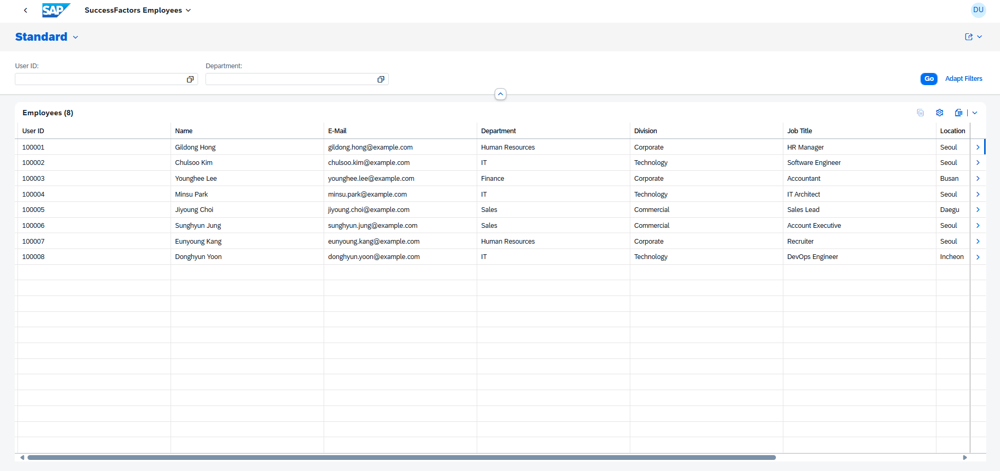
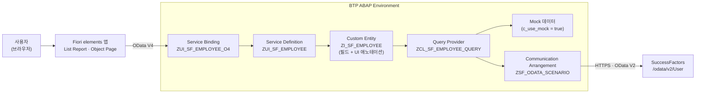
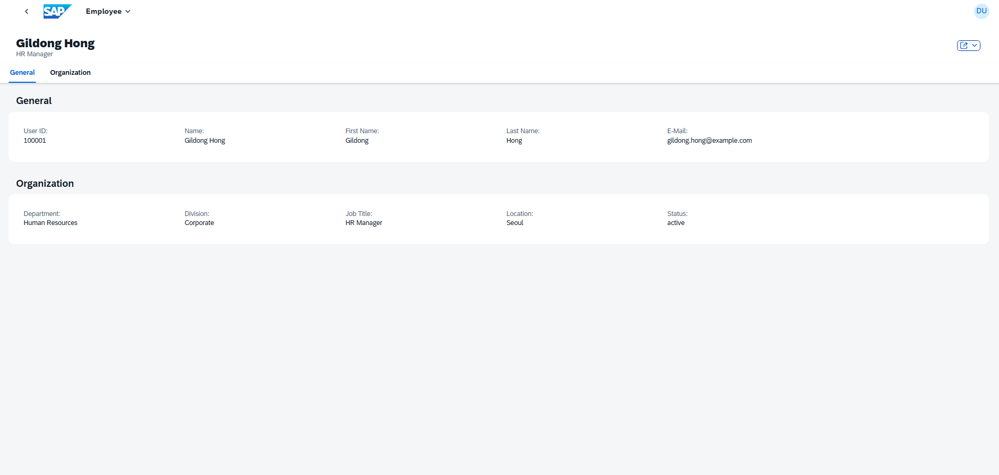

# SuccessFactors 직원 조회 — BTP ABAP · RAP · Fiori elements

> SuccessFactors 데이터를 복제하지 않고, BTP ABAP Environment에서 실시간으로 조회하는 Clean Core 방식의 side-by-side 확장 앱입니다.



| 항목 | 내용 |
|---|---|
| 대상 업무 | SuccessFactors 직원 정보 조회 (목록 · 상세) |
| 백엔드 | SAP BTP ABAP Environment, ABAP Cloud, RAP **Custom Entity** + Query Provider |
| 연동 | SuccessFactors OData V2 `User` 엔티티, Communication Scenario / Arrangement |
| 프론트엔드 | SAP Fiori elements V4 (List Report + Object Page), CDS UI 애노테이션 |
| 개발 도구 | ADT(Eclipse), SAP Business Application Studio, SAP Fiori tools |
| 실행 모드 | Mock(샘플 8명, SF 테넌트 불필요) ↔ 실제 SF 연동, 상수 한 줄로 전환 |

---

## 1. 왜 이 구조인가

S/4HANA Cloud(PCE)와 SuccessFactors 환경에서는 **표준 시스템을 수정하지 않는 Clean Core**가 원칙입니다. 확장 기능은 BTP에서 만들고, 표준 시스템과는 공개 API로만 연결해야 업그레이드 영향이 없습니다.

이 앱은 그 원칙을 따라 설계했습니다.

- **데이터 복제 없음**: SF 데이터를 별도 테이블에 저장하지 않고, 조회 시점마다 SF OData API를 호출 (RAP Custom Entity)
- **공개 API만 사용**: ABAP Cloud 릴리스 API(`CL_HTTP_DESTINATION_PROVIDER`, `CL_WEB_HTTP_CLIENT_MANAGER`)만 사용
- **접속 정보 분리**: 호스트·인증 정보는 코드가 아니라 Communication Arrangement에서 관리. 개발/운영 환경 전환 시 코드 변경 불필요
- **UI는 애노테이션으로**: 화면 레이아웃을 CDS 애노테이션으로 선언하고 Fiori elements가 렌더링. 프론트엔드 코드 없이 표준 UX 확보

## 2. 아키텍처



| 오브젝트 | 역할 |
|---|---|
| `ZI_SF_EMPLOYEE` | Custom Entity. 10개 필드 정의, `@UI.lineItem` · `@UI.facet` · `@UI.selectionField`로 목록/상세/검색 조건 선언 |
| `ZCL_SF_EMPLOYEE_QUERY` | `IF_RAP_QUERY_PROVIDER` 구현. Fiori 요청(페이징·정렬·필터)을 SF OData 쿼리로 변환하고 JSON 응답을 엔티티로 매핑 |
| `ZCX_SF_EMPLOYEE_ERROR` | 예외 클래스. SF 응답 오류를 RAP 프레임워크로 전달 |
| `ZUI_SF_EMPLOYEE` / `_O4` | Service Definition / OData V4 UI Service Binding |
| `app/` | Fiori tools로 생성한 List Report V4 앱 (`sap_horizon` 테마) |

## 3. 구현 포인트

**서버 사이드 처리 위임.** Fiori가 보내는 `$top` · `$skip` · `$orderby`와 총건수 요청을 SF 쿼리(`$top`, `$skip`, `$orderby`, `$inlinecount=allpages`)로 변환해 SF에 위임합니다. 데이터가 많아도 ABAP에서 전체를 받아 자르지 않습니다.

**필드 매핑.** SF에는 없는 `Full Name`으로 정렬하면 `lastName` 기준으로 변환하는 등, 화면 필드와 SF 속성 간 차이를 Query Provider에서 흡수합니다.

**Mock ↔ 실제 전환.** `c_use_mock` 상수 하나로 샘플 데이터와 SF 실연동을 전환합니다. SF 테넌트 없이 화면·서비스를 먼저 완성하고, 연동은 나중에 붙일 수 있습니다.

```abap
CONSTANTS:
  c_use_mock TYPE abap_bool VALUE abap_true,          " false로 바꾸면 SF 실연동
  c_scenario TYPE c LENGTH 30 VALUE 'ZSF_ODATA_SCENARIO',
  c_service  TYPE c LENGTH 40 VALUE 'ZSF_ODATA_REST'.
```

**SF 권한·인증.** SF 쪽에서는 API 전용 기술 사용자에 `User` 엔티티 읽기 권한(RBP)만 부여하고, 인증은 OAuth 2.0 SAML Bearer를 권장 방식으로 설계했습니다.



## 4. 현재 한계와 다음 단계

| 구분 | 내용 |
|---|---|
| 필터 | 실연동 모드에서는 `User ID`, `Department`의 단일 값(EQ)만 SF로 전달. 범위·다중 값은 Mock 모드에서만 동작 |
| 쓰기 | 조회 전용. 생성·수정이 필요하면 Unmanaged RAP BO로 확장 필요 |
| JSON 파싱 | `/UI2/CL_JSON` 사용. 인스턴스에서 미제공 시 `XCO_CP_JSON`으로 교체 |
| 다음 단계 | SAP Business Accelerator Hub 샌드박스 API로 실데이터 연동 검증, Employee Central 엔티티(`EmpJob` 등)로 확장, Work Zone Launchpad 등록 |

## 5. 실행

1. ADT에서 BTP ABAP 인스턴스에 `abap/` 오브젝트를 생성·활성화 (예외 클래스 → 빈 Query Provider → Custom Entity → Query Provider 소스 → Service Definition 순)
2. Service Binding `ZUI_SF_EMPLOYEE_O4` (OData V4 – UI) Publish 후 Preview
3. BAS에서 `app/` 실행: `npm install && npm start` (Mock 메타데이터: `npm run start-mock`)

SF 연동 설정(Outbound Service, Communication System/Arrangement)과 배포 절차는 [`docs/SETUP.md`](docs/SETUP.md) 참고.

## 이 저장소의 다른 프로젝트

| 프로젝트 | 내용 |
|---|---|
| [PA20 · PA30 · PA40 → SAP Fiori 재구성](pa-fiori/README.md) | SAPGUI 인사 마스터 트랜잭션을 시간 제약 규칙까지 재현한 SAPUI5 앱. 업무 로직 테스트 44건 |
| [PA20 · PA30 · PA40 RAP 백엔드](abap/pa-rap/README.md) | 위 PA 프로토타입의 규칙을 BTP ABAP Environment의 managed RAP BO(draft)로 구현. TC1/TC2, 채용·조직변경·퇴사 액션 |
| [Employee Central 스타일 조직도](ec-orgchart/README.md) | 기준일 기반 조직 트리 · 부서 상세 · 인원 집계 SAPUI5 앱. 업무 로직 테스트 16건 |

---

**작성자** 박건희 · SAP HR(HCM) 컨설턴트/개발자
