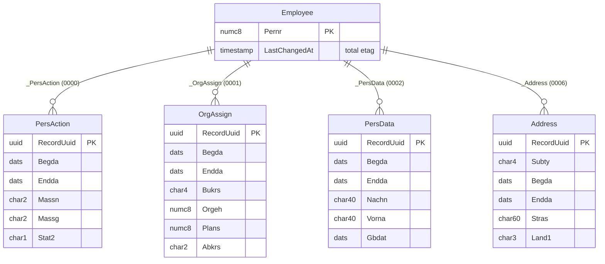

# PA30 RAP Business Object 설계

`pa-fiori/` 프로토타입의 서비스 계층(`PALogic.js`)을 BTP ABAP Environment의 RAP BO로 옮기기 위한 설계입니다.
목표는 화면을 그대로 두고 **업무 규칙을 백엔드로 내리는 것**, 그리고 그 과정에서 PCE에서 쓰는 개발 방식(ABAP Cloud, managed RAP, draft)을 직접 써 보는 것입니다.

> 구현 전에 작성한 설계 문서입니다. 구현하면서 바뀐 점은 [README의 "설계에서 바뀐 점"](README.md#6-설계에서-바뀐-점)에 정리했습니다.

---

## 1. 결정 사항 요약

| 항목 | 결정 | 이유 |
|---|---|---|
| 구현 방식 | **managed** + **draft** | BTP에서는 자체 테이블을 쓰므로 managed가 자연스러움. draft로 "편집 → 저장" 흐름이 PA30과 같아짐 |
| BO 루트 | 직원(`Employee`, 키 `Pernr`) | 잠금 단위가 직원. PA30의 직원 잠금(Enqueue)과 RAP의 lock master가 정확히 대응 |
| 자식 엔티티 | **인포타입별 고정 엔티티** 4개 | ECC 연동 설계 문서와 같은 결론: 필드백(범용 key-value)보다 필드 검증·권한·UI 애노테이션이 쉬움 |
| 자식 키 | UUID (`RecordUuid`) | TC 규칙 때문에 시작일·종료일이 바뀌므로, 날짜를 키로 쓰면 키가 변경됨. 날짜 중복은 검증으로 막음 |
| 사원번호 | 루트 early numbering + 번호범위 객체 `ZPA_PERNR` | 채용 액션에서 번호 부여. 프로토타입의 "최대값 + 1"을 대체 |
| 직원 생성 | 목표는 `Hire` 액션으로만 생성 (`internal create`). 개발 중에는 미리보기 테스트를 위해 임시로 `create` 허용 |
| 인포타입 0000 | 외부에서 생성·수정·삭제 불가 (internal) | 프로토타입과 같음. 인사발령 액션으로만 생성 |
| 인사발령(PA40) | 루트의 액션 3개 (채용·조직변경·퇴사) | 한 트랜잭션에서 0000과 Info Group을 같이 생성. 검증 실패 시 전체 저장 안 됨 |

## 2. 엔티티 구조

(필드는 대표 항목만 표시. 전체는 `tables/`, `cds/` 참고)

| 엔티티 | CDS | 테이블 | 시간 제약 |
|---|---|---|---|
| Employee | `ZR_PA_Employee` | `zpa_emp` | – |
| PersAction (0000) | `ZR_PA_PersAction` | `zpa_it0000` | TC1, 액션으로만 생성 |
| OrgAssign (0001) | `ZR_PA_OrgAssign` | `zpa_it0001` | TC1 |
| PersData (0002) | `ZR_PA_PersData` | `zpa_it0002` | TC1 |
| Address (0006) | `ZR_PA_Address` | `zpa_it0006` | TC2 (서브타입별) |

## 3. 프로토타입 로직 → RAP 기능 대응

핵심은 "거부할 것"과 "자동으로 고칠 것"을 나누는 것입니다. 자동 조정은 **determination**(이웃 레코드 수정), 거부와 최종 보장은 **validation**(저장 시점 무결성 검사)이 맡습니다. 처음에는 거부를 precheck에 두려 했지만, Fiori draft가 날짜 없이 레코드를 먼저 만들기 때문에 validation으로 옮겼습니다.

| `PALogic.js` | 동작 | RAP 대응 |
|---|---|---|
| `lock` / `unlock` / `getLock` | 직원 단위 잠금, 타 사용자 잠금 시 거부 | 루트 `lock master total etag` (draft 편집 시작 시 자동 잠금) |
| `checkEditable` | 퇴사자·0000 수정 차단 | instance feature control (`features : instance`) |
| `doCreate` 거부: `BEFORE_FIRST`, `SAME_START`, `OVERLAP` | 첫 레코드 이전, 같은 시작일, TC2 겹침 | validation `checkTimeConstraint` (Prepare에서 실행) |
| `doCreate` 조정: 이전 레코드 한정, `SPLIT_TAIL`, `END_ADJUSTED` | 포함 레코드를 begda−1로 한정, 필요 시 꼬리 레코드 분할 | **determination** `applyTimeConstraint on save { create; }` (0001에서 시작) |
| `change` | 날짜·서브타입은 변경 불가, 값만 변경 | `field ( readonly : update ) Begda, Endda, Subty` |
| `delimit` (TC2만) | 종료일을 앞당김 | Address의 **action** `Delimit` (파라미터: 새 종료일) |
| `remove` (TC1) | 이전 레코드 연장 / 첫 레코드면 다음 레코드 시작일 당김 / 마지막 1건 삭제 불가 | 표준 delete는 internal로 막고 **action** `RemoveRecord`로 제공 |
| `remove` (TC2) | 단순 삭제 | 표준 `delete` |
| `validateFields` | 필수값 | `field ( mandatory )` + validation `checkMandatory` |
| (전체 무결성) | TC1 공백·겹침 없음, 마지막 레코드 9999-12-31 | validation `checkTimeConstraint on save` (draft는 Prepare에도 등록) |
| `executeAction` (채용) | 신규 사번 + 0000/0002/0001/0006 일괄 생성, 실패 시 전체 롤백 | 루트 **static factory action** `Hire` |
| `executeAction` (조직변경·퇴사) | 0000 + 0001 / 0000만 생성 | 루트 **instance action** `Reassign`, `Leave` |
| `nextPernr` | 최대값 + 1 | 루트 **early numbering** + 번호범위 객체 |
| `stamp` | 변경자·변경일 기록 | 관리 필드 + `@Semantics` 애노테이션 (managed가 자동 기록) |

### TC1 삭제를 액션으로 바꾼 이유

TC1 삭제는 삭제 자체보다 **이웃 레코드 날짜 조정**이 본질입니다. 표준 delete에 determination을 거는 방식은 릴리스에 따라 지원 범위가 달라 확인이 필요하고, "마지막 1건 삭제 불가"를 feature control로 표현하기도 깔끔하지 않습니다. 액션 `RemoveRecord`로 두면 이웃 조정과 삭제를 한 메서드에서 처리하고, 버튼 활성화도 instance feature control로 제어할 수 있습니다.

### draft와 TC 규칙

처음 설계는 determination을 `on modify`로 두어 레코드를 추가하는 즉시 이전 레코드가 잘리는 모습을 보여주려 했습니다. 하지만 Fiori draft에서는 레코드가 **빈 상태로 먼저 생성되고 시작일·종료일이 나중에 채워지기** 때문에, 생성 시점에는 날짜를 알 수 없습니다. 그래서 0001은 `on save`로 바꾸고, **Prepare에 determination과 validation을 함께 등록**했습니다. 저장 버튼을 누르면 Prepare가 draft에서 먼저 조정·검사하므로 오류가 draft 레코드의 필드에 표시됩니다. 이어지는 Activate에서 같은 determination이 다시 돌지만, 이미 조정된 상태라 아무것도 바꾸지 않습니다(멱등). 조정 결과는 저장 후 화면과 정보 메시지(`DELIMITED_PREV`, `SPLIT_TAIL`)로 확인합니다.

저장 전에 결과를 미리 보여주려면 `on modify { create; field Begda, Endda; }` + side effects 조합을 다시 검토할 수 있습니다(재실행되어도 결과가 같도록 작성 필요).

## 4. 인사발령(PA40) 액션

| 액션 | 종류 | 파라미터 | 생성하는 레코드 | 사용 가능 조건 |
|---|---|---|---|---|
| `Hire` | static factory | `ZA_PA_HireParam` | Employee + 0000(01) + 0002 + 0001 + 0006(서브타입 1) | 항상 |
| `Reassign` | instance | `ZA_PA_ReassignParam` | 0000(02) + 0001 | 재직 중 (Stat2 ≠ 0) |
| `Leave` | instance | `ZA_PA_LeaveParam` | 0000(10, Stat2 = 0) | 재직 중 |

모든 생성은 액션 구현 안에서 `MODIFY ENTITIES ... IN LOCAL MODE`로 하고, 0001·0002 생성은 일반 생성과 같은 determination(`applyTimeConstraint`)을 탑니다. 즉 **발령도 같은 TC 규칙을 거칩니다.** 검증 하나라도 실패하면 RAP 저장 시퀀스 전체가 거부되므로, 프로토타입의 `rollback()`을 직접 구현할 필요가 없습니다.

draft BO이므로 `Hire`는 draft 직원을 만들고, 사용자가 저장(Activate)할 때 검증이 돌아 확정됩니다. "입력 → 실행 → 저장"이 한 화면에서 끝나는 PA40과 사용감을 맞추려면, UI에서 액션 직후 자동으로 저장하게 할지 결정이 필요합니다(7절).

## 5. 잠금 · 동시성 · 권한

- **잠금**: 루트 `lock master`, 자식 `lock dependent by _Employee`. draft 편집을 시작하면 활성 인스턴스가 잠기고, 다른 사용자는 편집할 수 없습니다(PA30의 "locked by HRADMIN2").
- **동시성**: 루트 `total etag LastChangedAt`, 각 엔티티 `etag master LocalLastChangedAt`.
- **권한**: 루트 `authorization master ( instance, global )`, 자식 `dependent`. ECC의 `P_ORGIN`(인사영역·인포타입·읽기/쓰기)을 흉내 낸 커스텀 권한 객체 `ZPA_ORGIN`을 두고 instance authorization에서 검사합니다. 조회(PA20)와 유지보수(PA30) 역할 분리도 이 객체의 활동(ACTVT)으로 구분합니다.
- **조회 권한**: CDS에 DCL(`@AccessControl.authorizationCheck: #CHECK`)을 붙여 같은 권한 객체로 행 단위 필터. 초안 소스는 우선 `#NOT_REQUIRED`로 두었습니다.

## 6. PCE(S/4HANA)로 옮긴다면

이 BO는 자체 테이블을 쓰는 **BTP side-by-side** 설계입니다. 같은 기능을 PCE의 HCM for S/4HANA 위에서 만든다면 구조가 달라집니다.

| 구분 | BTP (이 설계) | PCE on-stack |
|---|---|---|
| 데이터 | 자체 테이블 `zpa_*` | 표준 PA 테이블(PA0001 등) |
| 구현 방식 | managed | **unmanaged** (표준 저장 로직 호출) |
| 시간 제약 처리 | 직접 구현 (determination) | 표준 인포타입 처리 로직이 담당 (예: `HR_INFOTYPE_OPERATION`) |
| Clean Core 등급 | Tier 1 (ABAP Cloud만 사용) | 표준 HR 함수가 릴리스 API가 아니면 **Tier 2 래퍼** 필요: 클래식 ABAP 래퍼 클래스를 만들어 Tier 1 코드에 C1 계약으로 공개 |

즉 "TC 규칙을 직접 구현해 본 경험"과 "PCE에서는 표준 로직을 래퍼로 감싸 Tier 1에서 호출해야 한다"는 판단을 함께 보여줄 수 있습니다. 해당 릴리스에서 HR 인포타입용 릴리스 API가 있는지는 SAP API Business Hub / 릴리스 상태 정보로 확인해야 합니다.
