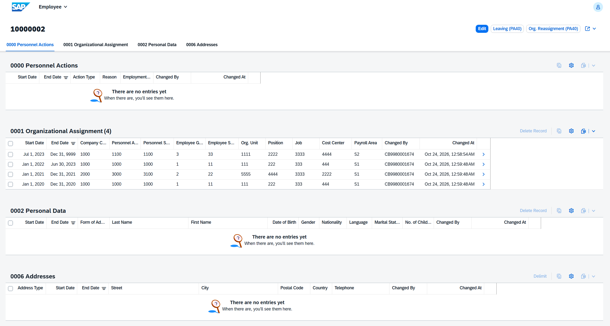
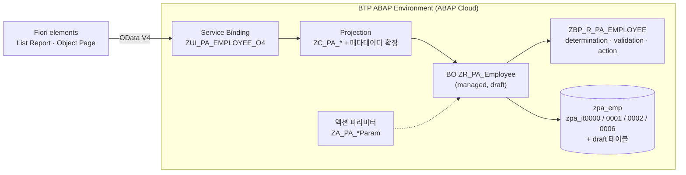
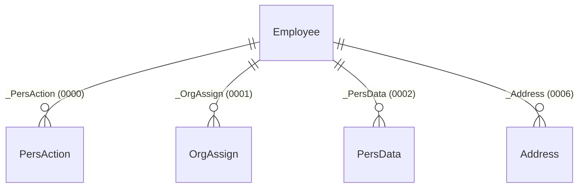
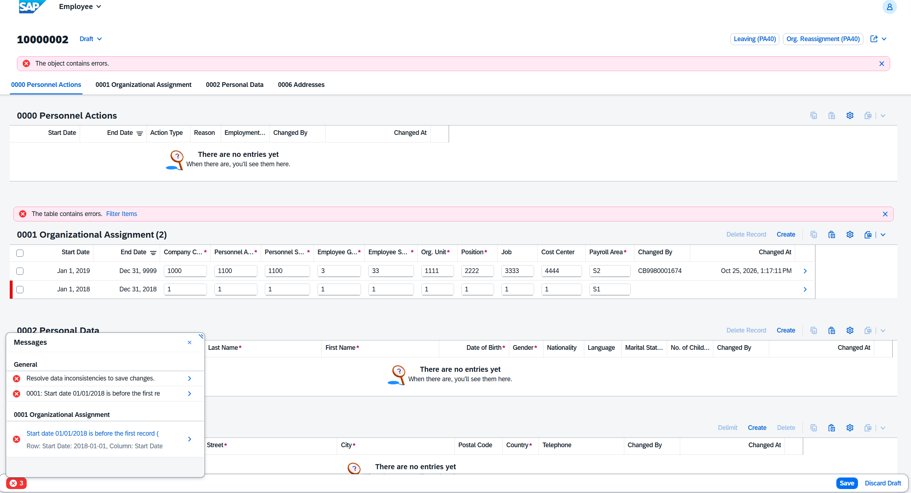
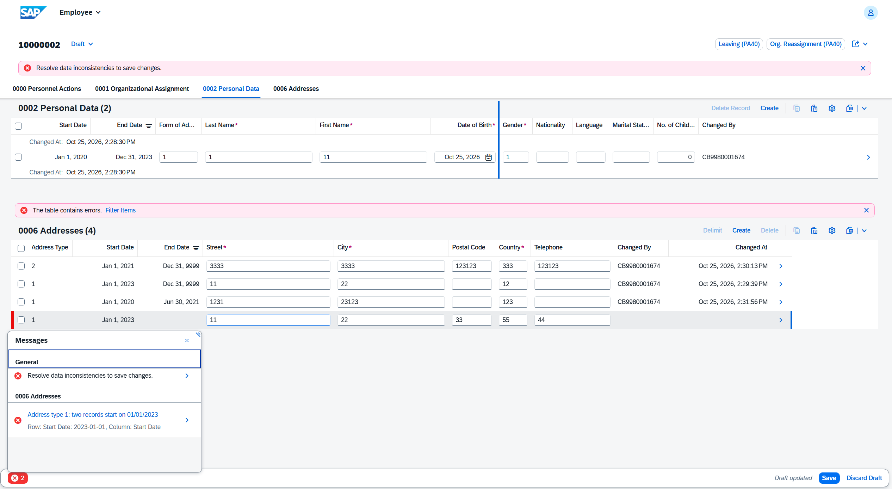
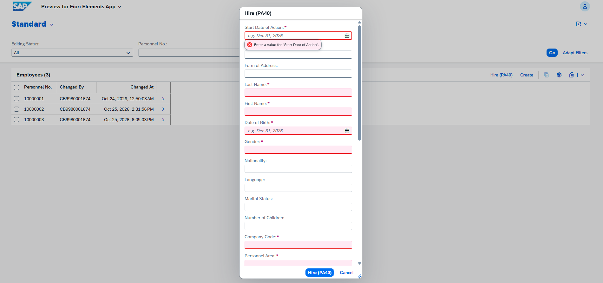
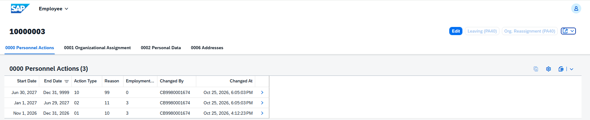

# PA20 · PA30 · PA40 — RAP 백엔드 (BTP ABAP Environment)

> Fiori 프로토타입(`pa-fiori/`)이 JavaScript로 흉내 내던 SAP HR 인사 마스터 규칙을, SAP BTP ABAP Environment의 **managed RAP Business Object**로 옮겨 실제 서버에서 동작시켰습니다.



| 항목 | 내용 |
|---|---|
| 대상 업무 | 인사 마스터 조회(PA20) · 유지보수(PA30) · 인사발령(PA40) |
| 인포타입 | 0000 인사조치 · 0001 조직배정 · 0002 개인데이터 · 0006 주소 |
| 기술 | ABAP Cloud, RAP managed + draft, CDS View Entity, BDEF (strict 2), EML, OData V4, Fiori elements (List Report / Object Page) |
| 환경 | SAP BTP ABAP Environment (Trial), ADT (Eclipse) |
| 상태 | 전 오브젝트 활성화, Fiori elements 미리보기로 시나리오 검증 완료 |

---

## 1. 무엇을 옮겼나

프로토타입의 `PALogic.js`에 있던 규칙을 RAP 기능에 하나씩 대응시켰습니다.

| 업무 규칙 | 프로토타입 | RAP 구현 |
|---|---|---|
| 직원 단위 잠금 | `lock` / `unlock` | 루트 `lock master total etag` (draft 편집 시작 시 자동 잠금) |
| TC1 이전 레코드 한정 · 꼬리 분할 | `doCreate` | determination `applyTimeConstraint` (on save, Prepare에서 실행) |
| TC1 공백 · 겹침 · 같은 시작일 · 첫 레코드 이전 거부 | `doCreate` 오류 코드 | validation `checkTimeConstraint` |
| TC1 삭제 시 이웃 레코드 연장 | `remove` | action `RemoveRecord` + 1건 남으면 버튼 비활성 (instance feature control) |
| TC2 같은 주소 유형끼리만 한정 · 겹침 거부 | `doCreate` (TC2) | 0006 determination / validation |
| TC2 종료일 앞당기기 | `delimit` | action `Delimit` (파라미터 팝업) |
| 날짜·서브타입은 생성 후 변경 불가 | `change` | `field ( readonly : update )` |
| 채용: 신규 사번 + 0000/0002/0001/0006 일괄 생성 | `executeAction` (01) | static factory action `Hire` + early numbering, 한 번의 deep create |
| 조직변경 · 퇴사 | `executeAction` (02, 10) | instance action `Reassign` / `Leave`, 0000 TC1 처리를 액션 안에서 수행 |
| 퇴사자에게 발령 불가 | 오류 | instance feature control로 버튼 비활성 |
| 직원은 채용으로만 생성 | – | 루트 `internal create` + `@UI.createHidden` |

## 2. 아키텍처





- 루트는 직원(`Pernr`), 자식은 인포타입별 고정 엔티티입니다. 범용 key-value 구조보다 필드 검증·UI 애노테이션이 명확합니다.
- 자식 키는 UUID입니다. TC 규칙이 시작일·종료일을 자동으로 바꾸므로 날짜를 키로 쓸 수 없습니다.
- 설계 배경과 결정 이유는 [DESIGN.md](DESIGN.md)에 있습니다.

## 3. 화면으로 본 검증 결과

**TC1 자동 분할 (0001)** — 2020 → 2023-07 → 2021(1년짜리) 순서로 추가. 2021 레코드가 끼어들면서 기존 레코드가 2020-12-31에 잘리고, 남은 기간(2022-01-01 ~ 2023-06-30)이 원래 값으로 다시 생성됨. 맨 위 그림.

**행 단위 오류 메시지** — 첫 레코드보다 이른 시작일은 종료일이 정확히 맞아도 거부(PA30과 동일). 해당 행과 칸이 표시됨.



**TC2 주소 (0006)** — 같은 유형끼리만 한정, 다른 유형은 공존, Delimit 후 공백 허용, 같은 시작일 거부.



**PA40 채용 팝업** — 필수 파라미터 표시와 서버 호출 전 검사.



**PA40 발령 이력 (0000)** — 채용(01) → 조직변경(02) → 퇴사(10)가 공백 없이 이어지고, 퇴사 후 발령 버튼이 비활성화됨.



## 4. 설계에서 바뀐 점

구현하면서 실제 시스템 동작을 보고 바꾼 부분입니다. 같은 문제를 만나는 사람에게 도움이 되도록 남겨 둡니다.

| 처음 설계 | 문제 | 바꾼 방식 |
|---|---|---|
| TC 조정을 `on modify`, 거부를 precheck로 | Fiori draft는 자식 레코드를 **날짜 없이 먼저 생성**하고 나중에 채움 → 생성 시점에 비교할 날짜가 없음 | determination을 `on save`로 바꾸고 **Prepare에 determination → validation 순서로 등록** |
| 검증을 Prepare에서 빼고 Activate 단계에서 실행 | active 인스턴스에 붙은 메시지를 화면이 매핑하지 못해 "Unspecified provider error"만 표시 | Prepare에서 draft 기준으로 검사 |
| 자식 메시지에 자기 키만 지정 | 화면에 "Resolve data inconsistencies"만 나오고 행에 표시되지 않음 | `%path`에 부모(직원) 키를 함께 지정 |
| `new_message_with_text`로 긴 문장 | 메시지 변수 하나(50자)에서 잘림 | 모든 메시지를 50자 이내로 재작성 |
| 파라미터 필수 지정에 `@ObjectModel.mandatory` | ABAP Cloud에서 릴리스되지 않은 애노테이션 | 파라미터용 abstract BDEF의 `field ( mandatory )` (이 릴리스에서는 `strict ( 2 )` 없이만 팝업에 반영됨) |
| 0000 TC1을 별도 determination으로 | 0000은 액션으로만 바뀌는 인포타입 | 액션 안에서 직접 한정 · 생성 |
| 루트 `internal create`만으로 생성 차단 | draft 목록 화면에 Create 버튼이 남음 | `@UI.createHidden: true` |

## 5. 폴더 구성

```
tables/      활성 테이블 5개 (zpa_emp, zpa_it0000/0001/0002/0006)
cds/         BO 뷰 ZR_PA_* (루트 + composition 자식 4개)
params/      액션 파라미터 ZA_PA_*Param (root abstract entity) + 필수 지정용 BDEF
bdef/        BO Behavior Definition (managed, draft, strict 2)
class/       Behavior Pool ZBP_R_PA_EMPLOYEE (Local Types에 핸들러 구현)
projection/  프로젝션 뷰 ZC_PA_* + 프로젝션 BDEF
mde/         UI 애노테이션 (메타데이터 확장)
service/     서비스 정의 ZUI_PA_EMPLOYEE
screenshots/ 검증 화면
DESIGN.md    설계 문서
```

## 6. 다시 만들기 (ADT)

1. 패키지 생성 (Superpackage `ZLOCAL`)
2. `tables/` 5개 활성화
3. `cds/` 5개를 **저장만** 한 뒤 한꺼번에 활성화 (루트와 자식이 서로 참조)
4. `params/` 엔티티 4개 활성화 → 각각 `params/bdef/` Behavior Definition 생성
5. `bdef/` BDEF 붙여넣기 → draft 테이블 5개와 구현 클래스는 ADT 퀵픽스(Ctrl+1)로 생성 → `class/`의 Local Types 내용으로 교체 → 함께 활성화
6. `projection/` 뷰 5개(저장 후 일괄 활성화) → 프로젝션 BDEF → `mde/` 5개 → `service/` → Service Binding (OData V4 - UI) Publish → Preview

## 7. 남은 과제

- ABAP Unit: 프로토타입의 44개 로직 테스트를 EML 기반 테스트로 이전
- side effects: 삭제 · 액션 후 형제 레코드 자동 갱신
- 권한: `P_ORGIN`에 해당하는 권한 객체로 조회 / 유지보수 역할 분리, CDS 접근 제어
- 사번 채번을 번호범위 객체로 전환 (현재는 최대값 + 1)
- 발령 유형 · 사유 등 값 도움말을 CDS 값 도움말 뷰로 제공

---

**작성자** 박건희 · SAP HR(HCM) 컨설턴트/개발자
