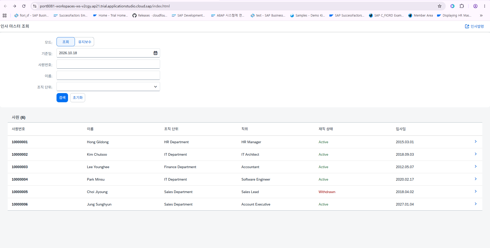
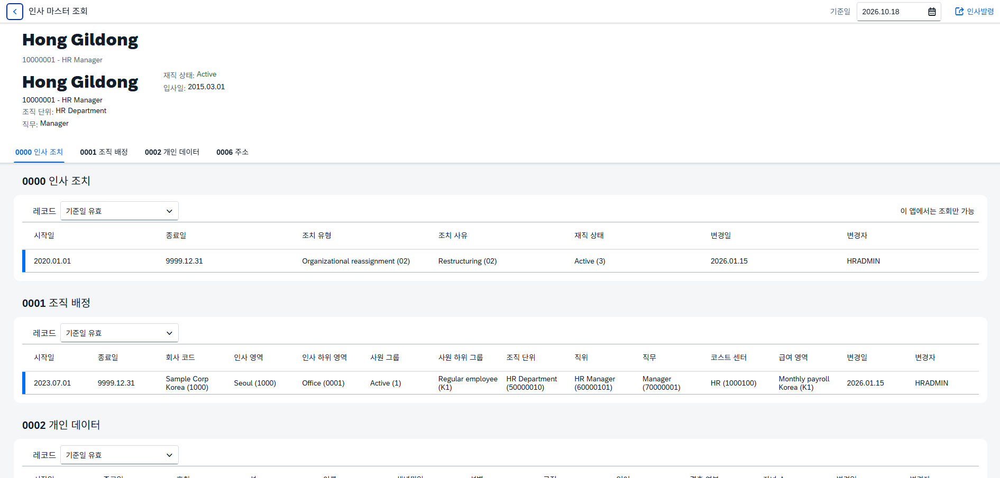
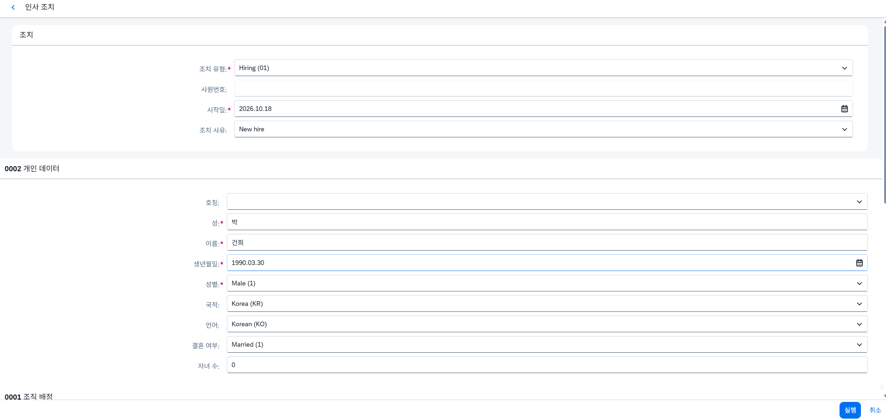
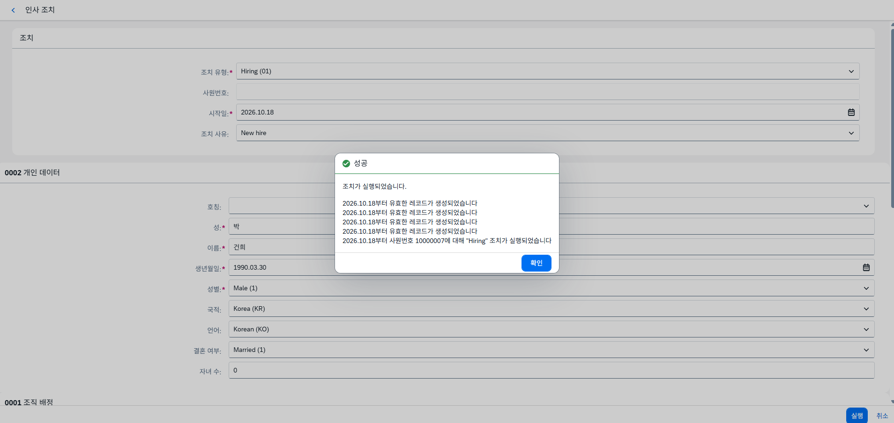
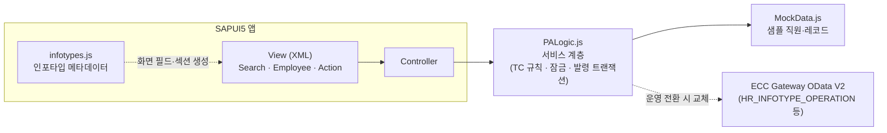

# PA20 · PA30 · PA40 → SAP Fiori 재구성

> SAPGUI 인사 마스터 트랜잭션 3종을, 시간 제약 규칙(Time Constraint)까지 그대로 살린 Fiori 앱으로 다시 설계했습니다.



| 항목 | 내용 |
|---|---|
| 대상 업무 | 인사 마스터 조회(PA20) · 유지보수(PA30) · 인사발령(PA40) |
| 인포타입 | 0000 인사조치 · 0001 조직배정 · 0002 개인데이터 · 0006 주소 |
| 기술 | SAPUI5 (freestyle, `sap.m`, `sap.uxap.ObjectPageLayout`), Horizon 테마, i18n(한/영) |
| 실행 환경 | SAP Business Application Studio, BTP ABAP Environment(Trial)에 배포 가능 |
| 품질 | 업무 로직 자동화 테스트 **44건 통과** + 정적 검사(XML/JSON/JS 구문, i18n 키 115개) |
| 데이터 | 인메모리 샘플 데이터 (ECC 연동 설계는 [`docs/ecc-integration.md`](docs/ecc-integration.md)) |

---

## 1. 왜 만들었나

PA20/PA30/PA40은 HR 실무에서 가장 많이 쓰는 트랜잭션이지만, SAPGUI 화면은 다음 문제가 있습니다.

- **인포타입마다 화면을 따로 열어야 함**: 한 직원의 조직·개인·주소 정보를 보려면 인포타입 번호를 바꿔가며 반복 조회
- **이력 파악이 어려움**: 기준일을 바꿔 가며 레코드를 하나씩 확인해야 과거/미래 시점의 상태를 알 수 있음
- **모바일·브라우저 접근 불가**: 현업 관리자는 SAPGUI 없이는 인사정보를 볼 수 없음

이 앱은 **"SAP HR의 규칙은 그대로, 화면 경험만 Fiori로"**를 목표로 했습니다. 규칙을 단순화한 데모가 아니라, PA30에서 실제로 일어나는 레코드 분할·한정(Delimit)·중복 차단을 재현하는 것이 핵심입니다.

## 2. 주요 기능

### 조회 (PA20)
- 사원번호 · 이름 · 조직단위로 검색, **기준일(Key date)** 기준 유효 레코드 표시
- 한 화면(Object Page)에 4개 인포타입을 섹션으로 배치. 레코드 범위를 "기준일 유효 / 전체 이력"으로 전환



### 유지보수 (PA30)
- **편집 시 직원 잠금(Enqueue)**: 다른 사용자가 잠근 직원은 수정 불가 메시지 표시
- 레코드 **생성 / 복사 / 변경 / 유효기간 한정(Delimit) / 삭제**
- 시간 제약 규칙 적용

| 규칙 | 적용 인포타입 | 동작 |
|---|---|---|
| TC1 (공백·중복 불가) | 0001, 0002 | 기간 중간에 새 레코드를 넣으면 이전 레코드가 자동 한정됨. 삭제 시 이전 레코드가 연장됨. 마지막 레코드는 삭제 불가 |
| TC2 (서브타입별, 중복 불가) | 0006 | 같은 주소 유형끼리만 중복 검사. 서로 다른 유형은 동시에 존재 가능 |
| 조회 전용 | 0000 | PA30에서 직접 수정 불가. 인사발령을 통해서만 생성 |

### 인사발령 (PA40)
- 채용(01) · 조직변경(02) · 퇴사(10)
- 발령 유형별 **Info Group**(채용: 0000 → 0002 → 0001 → 0006)을 한 화면에서 입력
- **트랜잭션 처리**: 어느 한 인포타입이라도 검증에 실패하면 전체가 롤백되어 아무것도 저장되지 않음
- 신규 채용 시 사원번호 자동 채번, 퇴사자·잠긴 직원에 대한 발령은 거부





## 3. 아키텍처



설계 포인트는 세 가지입니다.

1. **메타데이터 기반 UI**: 인포타입의 필드·값 목록을 `infotypes.js`에 선언하고, 화면 섹션과 테이블은 이 정의로부터 생성합니다. 인포타입을 추가할 때 View를 새로 만들 필요가 없습니다.
2. **서비스 계층 분리**: 컨트롤러는 데이터에 직접 접근하지 않고 `PALogic.js`만 호출합니다. 함수 시그니처(`{ok, errors:[{code, params}]}`)를 유지한 채 내부만 ECC OData 호출로 바꾸면 운영 전환이 됩니다.
3. **ECC 표준 동작 모사**: `PALogic.js`의 생성·변경·한정·삭제 로직은 ECC의 `HR_INFOTYPE_OPERATION`이 수행하는 시간 제약 처리를 그대로 따르도록 설계했습니다. 실제 연동 시 백엔드 동작과 화면 기대값이 어긋나지 않게 하기 위함입니다.

ECC 연동 설계(SEGW 엔티티 모델, 후보 FM/BAPI, 권한 P_ORGIN/P_PERNR, Cloud Connector + Principal Propagation)는 [`docs/ecc-integration.md`](docs/ecc-integration.md)에 정리했습니다.

## 4. 검증

`npm test`로 업무 로직 44건과 정적 검사를 실행합니다.

| 시나리오 | 사원번호 | 확인 내용 |
|---|---|---|
| 일반 이력 | 10000001 | 기준일 2021-03-01로 과거 레코드 표시 |
| 타 사용자 잠금 | 10000004 | 편집 시 "locked by HRADMIN2" |
| 퇴사자 | 10000005 | 상태 Withdrawn, 마지막 0000 레코드 확인 |
| 미래 입사자 | 10000006 | 오늘 기준 조회 시 가장 가까운 레코드 표시 |
| TC1 삽입 · 삭제 | 임의 | 이전 레코드 자동 한정 / 연장, 마지막 레코드 삭제 차단 |
| TC2 주소 | 10000001 | 동일 서브타입 중복 오류, 다른 서브타입 공존 |
| 채용 롤백 | 신규 | 필수값 누락 시 0000~0006 모두 저장 안 됨 |

## 5. 의도적으로 제외한 범위

프로토타입이므로 아래는 단순화했습니다. 운영 적용 시 보완 대상입니다.

- 발령 유형·사유 종속(T530), 동적 Info Group(피처 MNMAC, T588Z) 미구현 — 발령 3종 하드코딩
- 급여 변경(03)은 인포타입 0008이 필요해 제외
- 권한 오브젝트 체크, 국가별 화면(MOLGA) 미적용
- 단일 사용자(`DEMO_USER`) 기준

## 6. 실행

```bash
npm install
npm start      # http://localhost:8080/index.html
npm test       # 로직 테스트 + 정적 검사
```

유지보수 모드로 바로 시작: `index.html?mode=maintain`
BTP ABAP 배포 절차는 [`docs/SETUP.md`](docs/SETUP.md) 참고.

---

**작성자** 박건희 · SAP HR(HCM) 컨설턴트/개발자
